# 大闹天宫（DNTG）：人类设计的 PyFii 编码模式

> 状态：研究资料，2026-07-14 复核。动作片段保留 `tests/dntg20220730_v3.py` 当时的写法，用于分析编舞结构；新项目的读取和渲染示例已改为 `DroneTrack` 入口。

本文分析原始七机编舞 [tests/dntg20220730_v3.py](https://github.com/Kevin0412/pyfii/blob/pyfii-dev/tests/dntg20220730_v3.py) 的代码组织方式，并在对应设计方法下展示真实渲染结果。

> 截图由 [GitHub Actions](https://github.com/Kevin0412/pyfii/actions/workflows/render-screenshots.yml) 自动生成，使用同一 Fii 工程、60 FPS 采样、默认加速度模型（`ignore_acc=False`），不含音乐。OpenCV 与浏览器采用不同绘制后端；现代模拟截图不等同于历史无加速度模式的原始观感，也不代表飞行安全验收。每次成功发布的源码版本可在 [render-gallery 分支](https://github.com/Kevin0412/pyfii/tree/render-gallery) 核对。

## 阅读索引

- [一、直接式 pyfii 调用模式](#section-1)
- [二、数学轨迹表达](#section-2)
- [三、角色映射与分组](#section-3)
- [四、分组差异与错峰](#section-4)
- [五、数学驱动的灯光](#section-5)
- [六、最终图案与收束](#section-6)
- [七、验证验收](#section-7)
- [八、编码原则](#section-8)

<a id="section-1"></a>

## 一、直接式 pyfii 调用模式

`dntg20220730_v3.py` 不经过声明层，直接用 PyFii API 编排动作。每段有明确的 `startTime/endTime` 注释。下面的 `intime()` 和直接修改 `X/Y` 是历史样本原写法，不是新教程模板；新代码优先使用 `inittime()` 和构造函数起飞坐标。

```python
# 起飞
# startTime = 0s, endTime = 7s
d1 = pf.Drone()
d1.X = d1.x = 280
d1.Y = d1.y = 280
d1.takeoff(1, 120)       # 起飞到 120cm
d1.intime(4)             # 4s 开始主段
```

#### 6s · 六边形扩张与灯光

| OpenCV 2D | 浏览器 Canvas 2D |
| --- | --- |
| 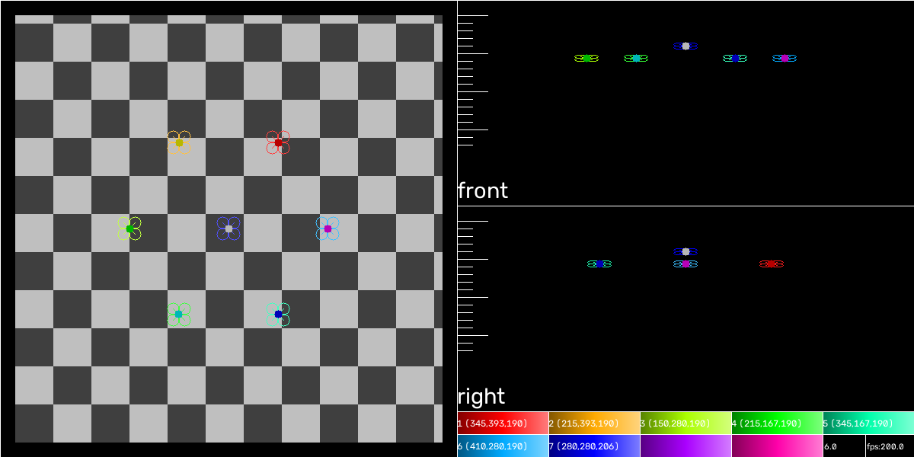 |  |

| OpenCV 3D | 浏览器 Three.js 3D |
| --- | --- |
| 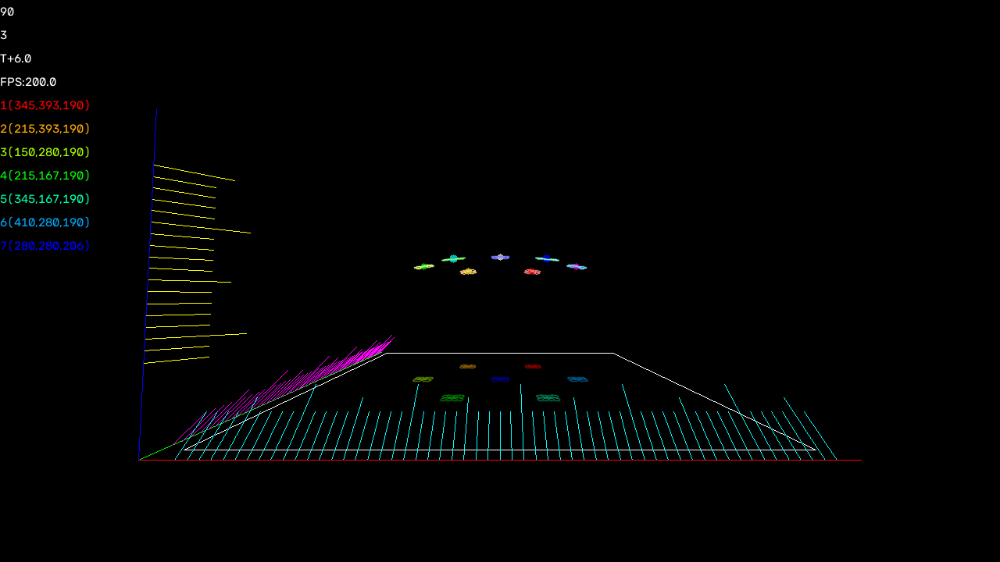 | 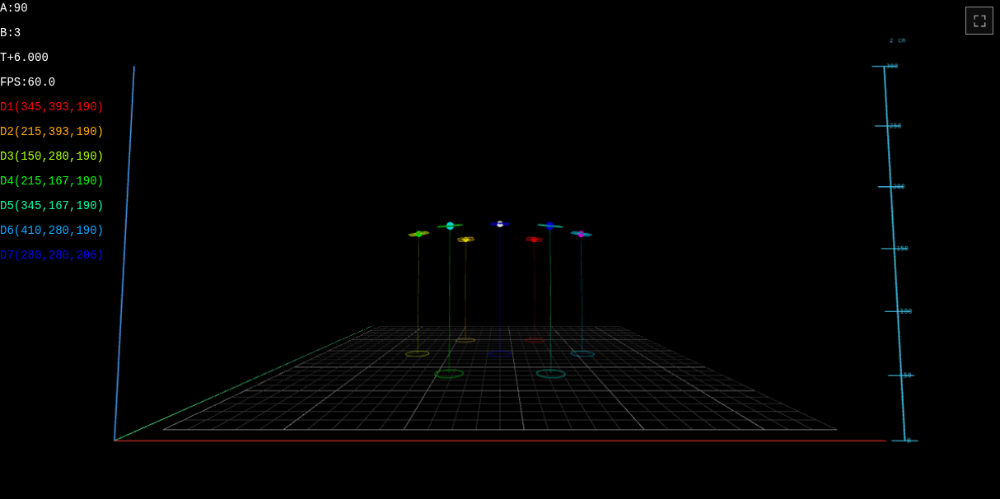 |

完整工作台：[2D](https://raw.githubusercontent.com/Kevin0412/pyfii/render-gallery/dntg/006000ms-browser-2d-studio.png) · [3D](https://raw.githubusercontent.com/Kevin0412/pyfii/render-gallery/dntg/006000ms-browser-3d-studio.png)

<a id="section-2"></a>

## 二、数学轨迹表达

用 `cmath` 和 `numpy` 表达连续运动，不逐点写坐标。

### 复数旋转

```python
import cmath

# 六边形起始位
d.X = int(280 + (E**(n/3*PI*1j)).real * 70 + 0.5)
d.Y = int(280 + (E**(n/3*PI*1j)).imag * 70 + 0.5)

# 段内旋转
theta = 2/3*PI*gn + PI/6*step + 2.5/3*PI
rotateV = E**(theta*1j)
move2autoz(d, (g1c[0] + R*rotateV.real, g1c[1] + R*rotateV.imag), 6000/10)
```

用 `E**(angle*1j)` 表达旋转向量，避免硬编码 `cos`/`sin`。

### 利萨如轨迹

```python
li = []
for a in range(24):
    li.append((
        280 + 320/3**0.5 * np.sin(2*a/24 * 2*np.pi),
        280 + 320/3**0.5 * np.sin(3*a/24 * 2*np.pi),
        165 + 128/3**0.5 * np.sin(4*a/24 * 2*np.pi + np.pi/2)
    ))
```

预计算轨迹点表，按索引分配。不同频率正弦波叠加形成复杂可控的空间曲线。

#### 13s · 利萨如轨迹

| OpenCV 2D | 浏览器 Canvas 2D |
| --- | --- |
|  | 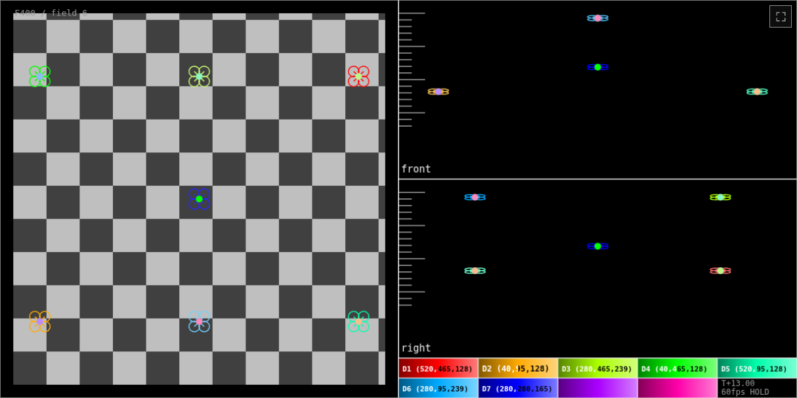 |

| OpenCV 3D | 浏览器 Three.js 3D |
| --- | --- |
| 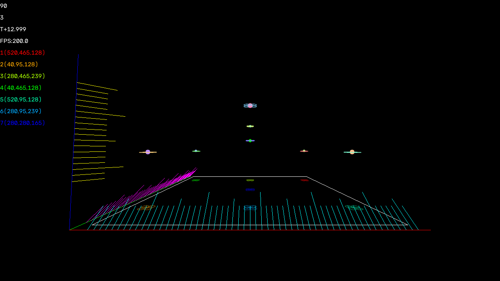 | 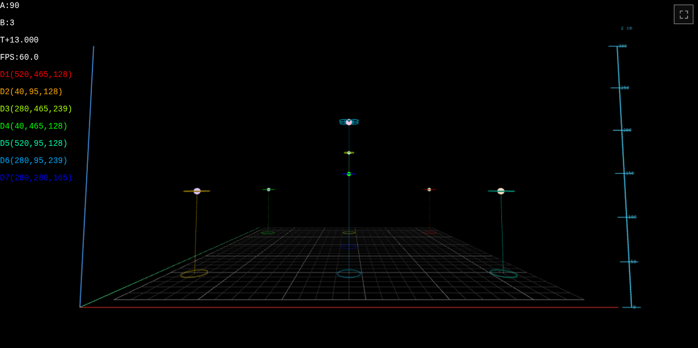 |

完整工作台：[2D](https://raw.githubusercontent.com/Kevin0412/pyfii/render-gallery/dntg/013000ms-browser-2d-studio.png) · [3D](https://raw.githubusercontent.com/Kevin0412/pyfii/render-gallery/dntg/013000ms-browser-3d-studio.png)

<a id="section-3"></a>

## 三、角色映射与分组

每段用字典重新分配角色，同一架机在不同段承担不同职责。

```python
n2gn = {1:3, 2:4, 3:5, 4:0, 5:2, 6:-1, 7:1}  # 机号 → 组号
n2sg = [None, 2, 1, 0, 6, 3, 5, 4]            # 机号 → 符号组

for d, n in zip(ds, range(7)):
    gn = n2gn[n+1]
    if gn == -1:
        d.TurnOnAll(RED)
        move2(d, (center.real, center.imag, baseH), 2000)
    else:
        iv, ih = (gn+step)%6, (gn+2*step)%6
        pos = center + rotateVs[iv]
        move2(d, (pos.real, pos.imag, baseH+dHs[ih]), 2000)
```

角色映射避免"固定中心/固定外圈"退化。

#### 49s · 三维旋转中的角色映射与高度相位

| OpenCV 2D | 浏览器 Canvas 2D |
| --- | --- |
|  | 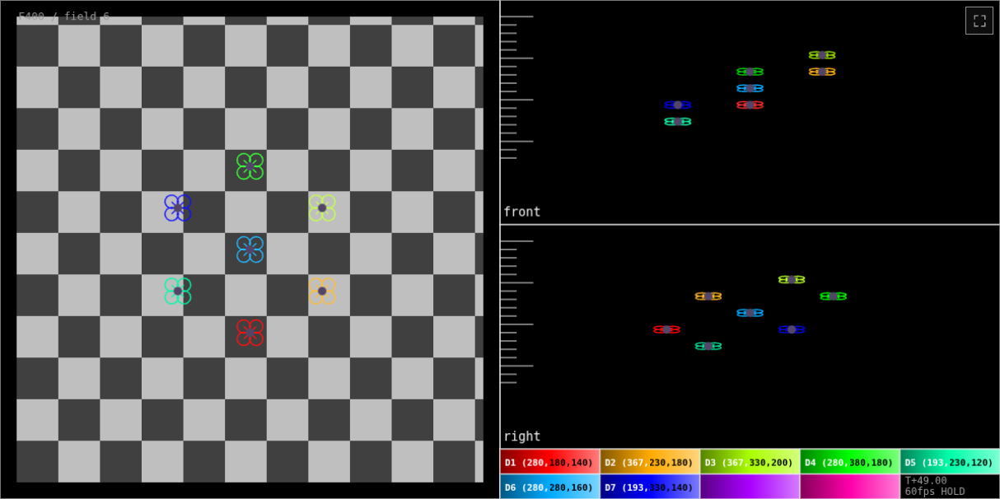 |

| OpenCV 3D | 浏览器 Three.js 3D |
| --- | --- |
| 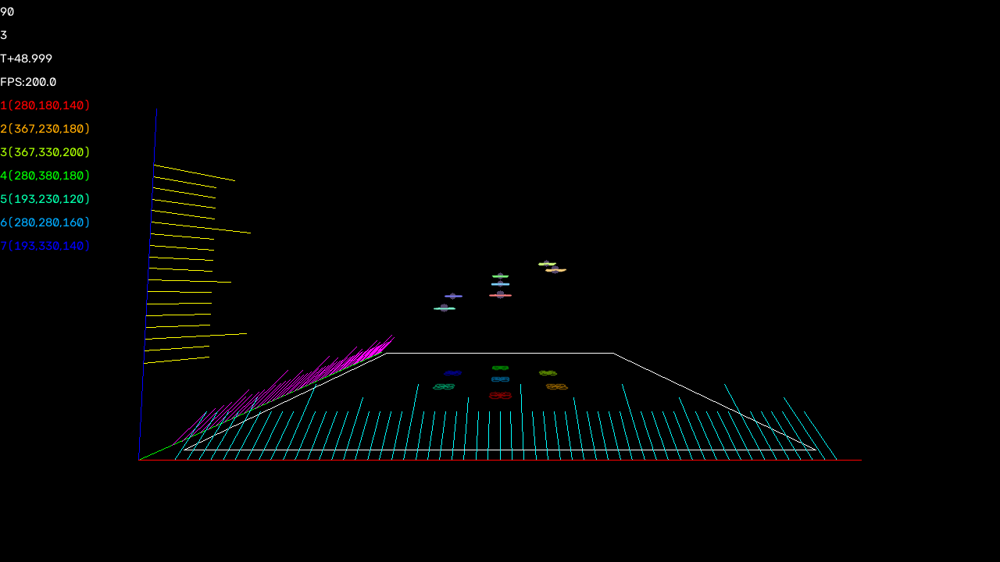 | 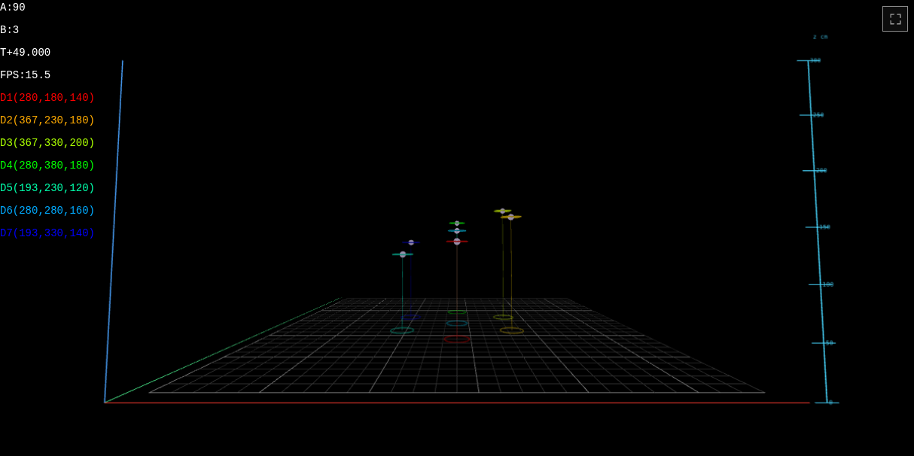 |

完整工作台：[2D](https://raw.githubusercontent.com/Kevin0412/pyfii/render-gallery/dntg/049000ms-browser-2d-studio.png) · [3D](https://raw.githubusercontent.com/Kevin0412/pyfii/render-gallery/dntg/049000ms-browser-3d-studio.png)

<a id="section-4"></a>

## 四、分组差异与错峰

同一段内不同机有完全不同的动作路径：

```python
if n == 0:                                    # 最左机
    d.intime(7)
    move2(d, (d.x-160, d.y, d.z), 1500)      # 先向左飞
    d.delay(1500)
    move2(d, (li[li1[n]][0]+li3[n], ...), 1500)
elif n == 6:                                  # 最右机
    d.intime(7)
    move2(d, (d.x+160, d.y, d.z), 1500)      # 先向右飞
    d.delay(1500)
    move2(d, (li[li1[n]][0]+li3[n], ...), 1500)
elif n == 3:                                  # 中心机
    d.intime(7)
    move2(d, (d.x, d.y-80*3**0.5, d.z), 1500) # 先向下飞
    d.delay(1500)
    b = sum(li[li1[a]][2] for a in [0,1,2,4,5,6]) / 6  # 计算平均高度
    move2(d, (280, 280, b), 1500)            # 回到中心
else:                                         # 其余机
    d.intime(7)
    d.delay(1500)                             # 等待
    move2(d, (li[li1[n]][0]+li3[n], ...), 1500)
```

先动/后动/长路径/短路径 = 错峰编排。

#### 25s · 斜对称

| OpenCV 2D | 浏览器 Canvas 2D |
| --- | --- |
| 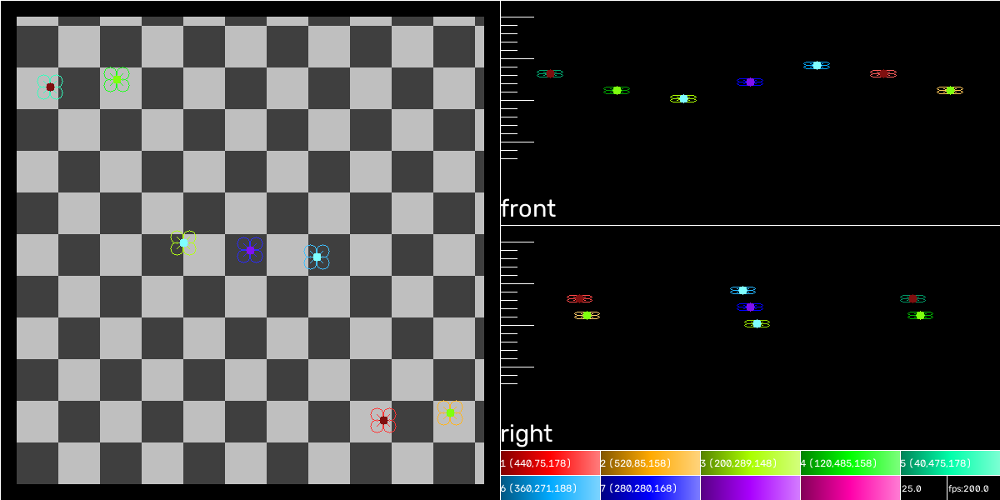 | 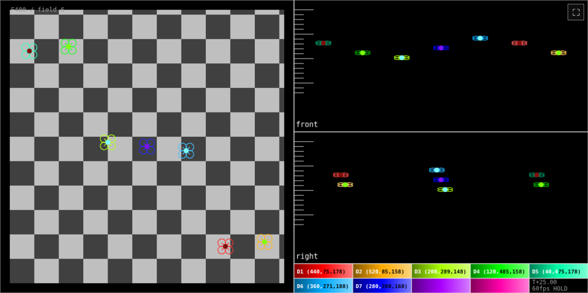 |

| OpenCV 3D | 浏览器 Three.js 3D |
| --- | --- |
| 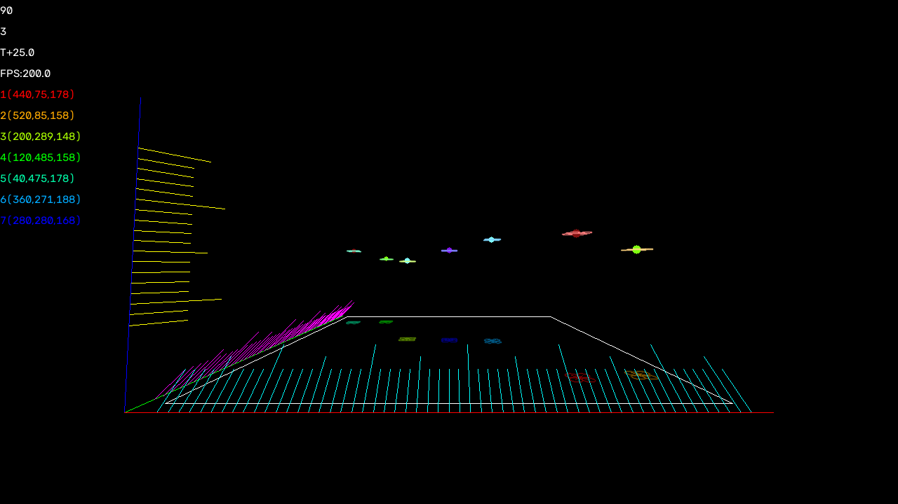 | 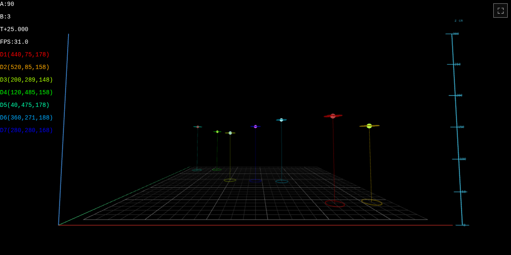 |

完整工作台：[2D](https://raw.githubusercontent.com/Kevin0412/pyfii/render-gallery/dntg/025000ms-browser-2d-studio.png) · [3D](https://raw.githubusercontent.com/Kevin0412/pyfii/render-gallery/dntg/025000ms-browser-3d-studio.png)

#### 33s · 平移旋转

| OpenCV 2D | 浏览器 Canvas 2D |
| --- | --- |
| 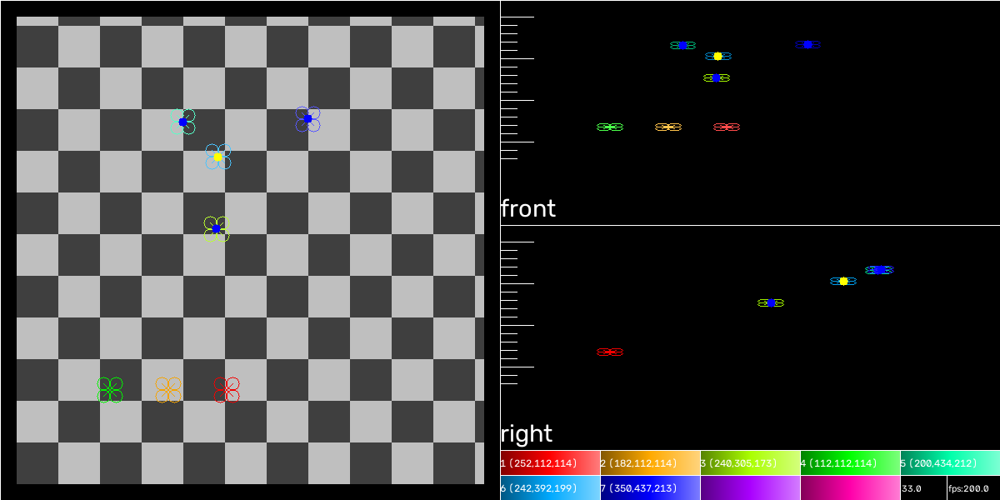 | 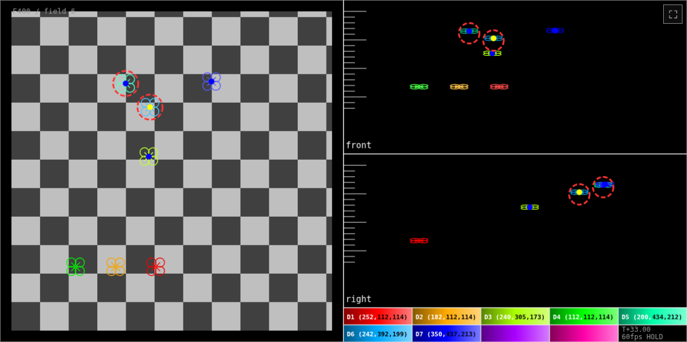 |

| OpenCV 3D | 浏览器 Three.js 3D |
| --- | --- |
| 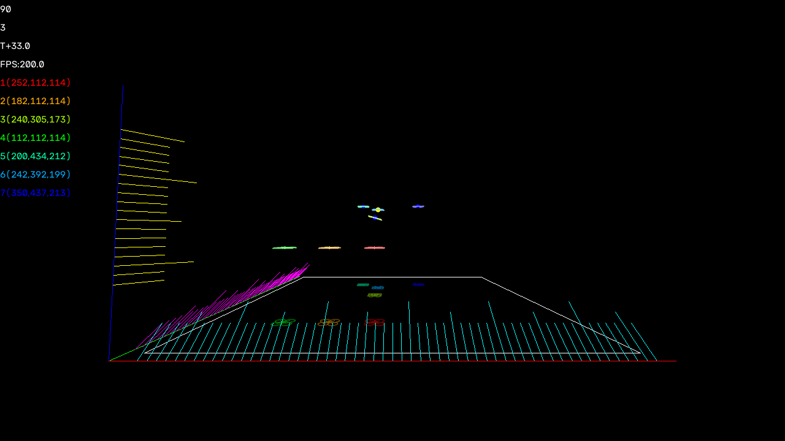 | 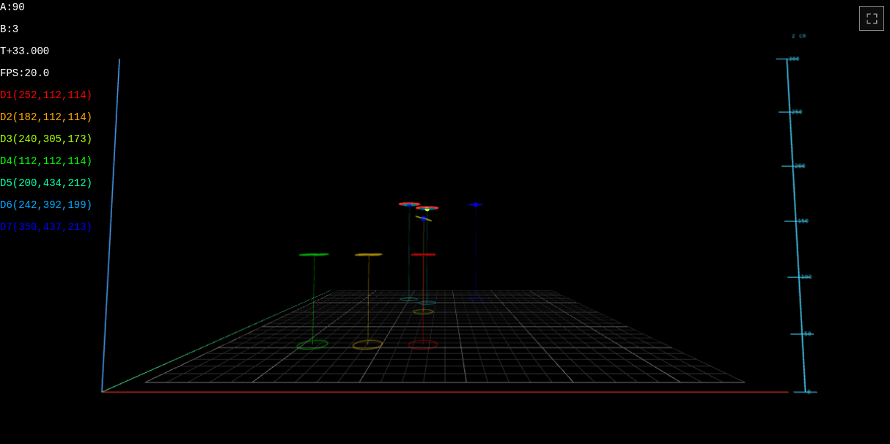 |

完整工作台：[2D](https://raw.githubusercontent.com/Kevin0412/pyfii/render-gallery/dntg/033000ms-browser-2d-studio.png) · [3D](https://raw.githubusercontent.com/Kevin0412/pyfii/render-gallery/dntg/033000ms-browser-3d-studio.png)

<a id="section-5"></a>

## 五、数学驱动的灯光

用三角函数生成连续变化的颜色序列：

```python
for a in range(20):
    d.TurnOnAll(rgb2str(
        int(160 + 95.5*np.sin(3*2*np.pi/20*a)),
        int(160 + 95.5*np.sin(4*2*np.pi/20*a)),
        int(160 + 95.5*np.sin(2*2*np.pi/20*a))
    ))
    d.delay(100)
```

RGB 三通道用不同频率正弦波驱动，20 步 100ms = 2s 颜色周期。不是静态颜色序列而是连续函数。

<a id="section-6"></a>

## 六、最终图案与收束

原脚本在 54s 和 59s 切换到两个符号组，通过 `n2sg` 将机号映射到目标点，再用 `move2autoz()` 将平面图案映射到高度。下面分别取 56s 和 61s 的现代模拟结果。

#### 56s · 镰刀

| OpenCV 2D | 浏览器 Canvas 2D |
| --- | --- |
| 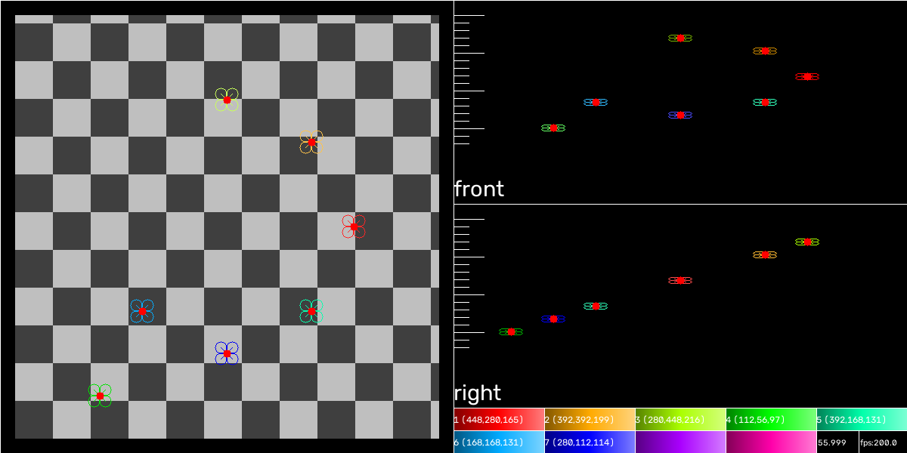 | 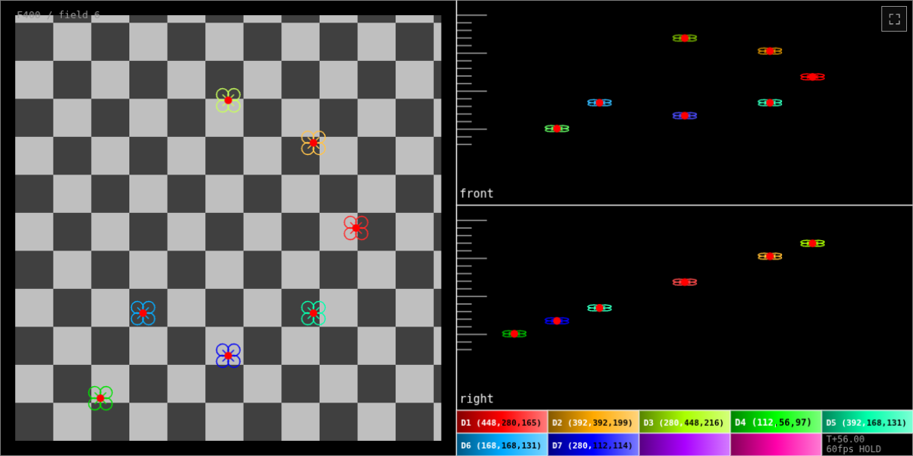 |

| OpenCV 3D | 浏览器 Three.js 3D |
| --- | --- |
| 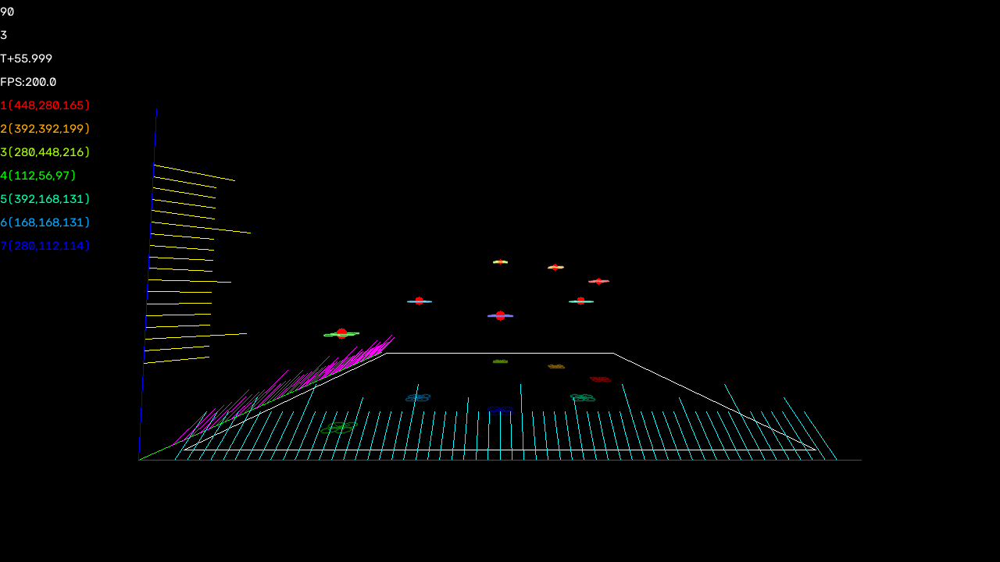 | 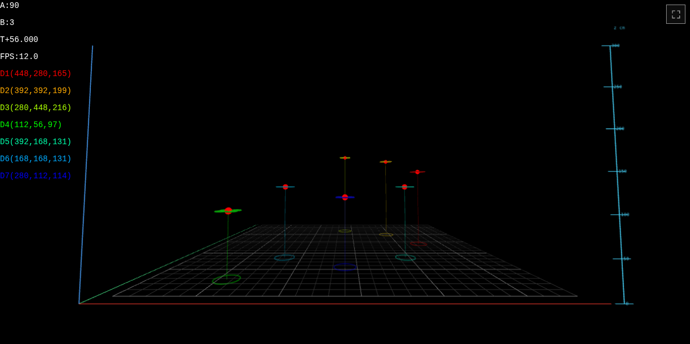 |

完整工作台：[2D](https://raw.githubusercontent.com/Kevin0412/pyfii/render-gallery/dntg/056000ms-browser-2d-studio.png) · [3D](https://raw.githubusercontent.com/Kevin0412/pyfii/render-gallery/dntg/056000ms-browser-3d-studio.png)

#### 61s · 锤子

| OpenCV 2D | 浏览器 Canvas 2D |
| --- | --- |
| 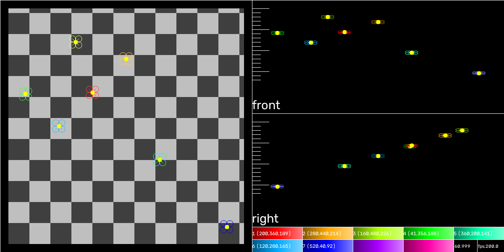 | 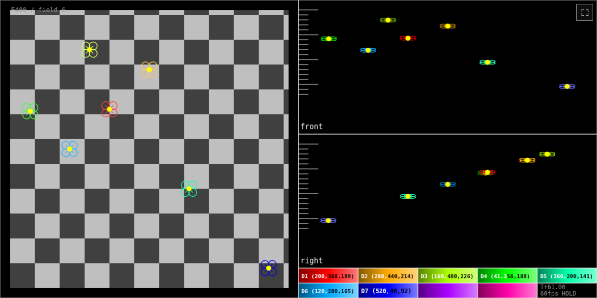 |

| OpenCV 3D | 浏览器 Three.js 3D |
| --- | --- |
| 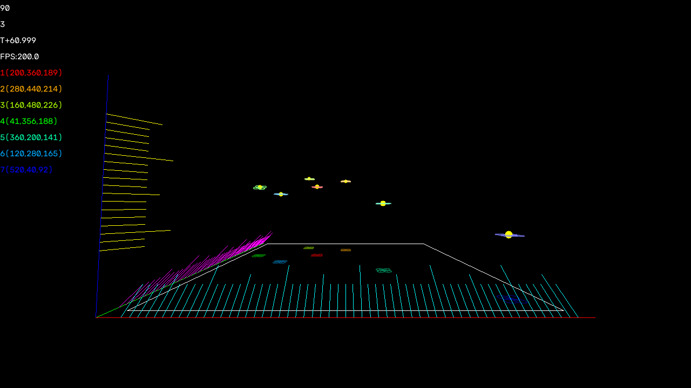 | 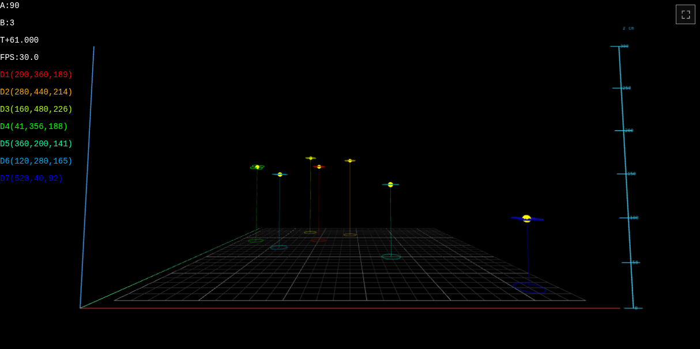 |

完整工作台：[2D](https://raw.githubusercontent.com/Kevin0412/pyfii/render-gallery/dntg/061000ms-browser-2d-studio.png) · [3D](https://raw.githubusercontent.com/Kevin0412/pyfii/render-gallery/dntg/061000ms-browser-3d-studio.png)

<a id="section-7"></a>

## 七、验证验收

```python
for d in ds:
    d.end()

F = pf.Fii('大闹天宫', ds, music=music_path)
F.save(infii=True)

track = pf.from_fii('大闹天宫', fps=200)
pf.show(track, save='大闹天宫', FPS=25)
```

当前闭环是 `Fii.save()` → `from_fii()` → `show(track)`。原脚本中的 `show(data, t0, music, ...)` 多参数调用仍保留兼容，但新封装和 GUI 应传 `DroneTrack`。

<a id="section-8"></a>

## 八、编码原则

1. **数学优于枚举**：用函数表达轨迹，不逐点写坐标
2. **角色可变化**：每段重新分配角色映射
3. **错峰编排**：同段内不同机的动作开始时间/路径长度有差异
4. **灯光参与设计**：灯光用数学函数生成，与动作同步
5. **辅助函数封装**：`move2()`, `move2autoz()` 封装常用模式
6. **段落注释**：每段注释 `startTime/endTime`
