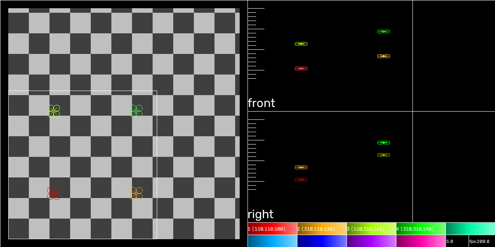
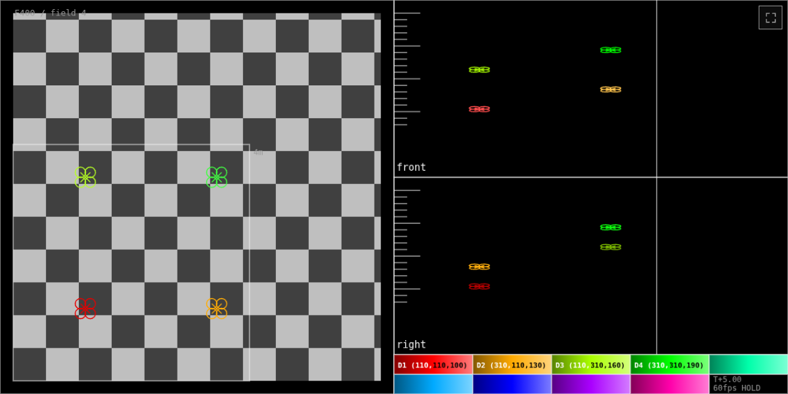
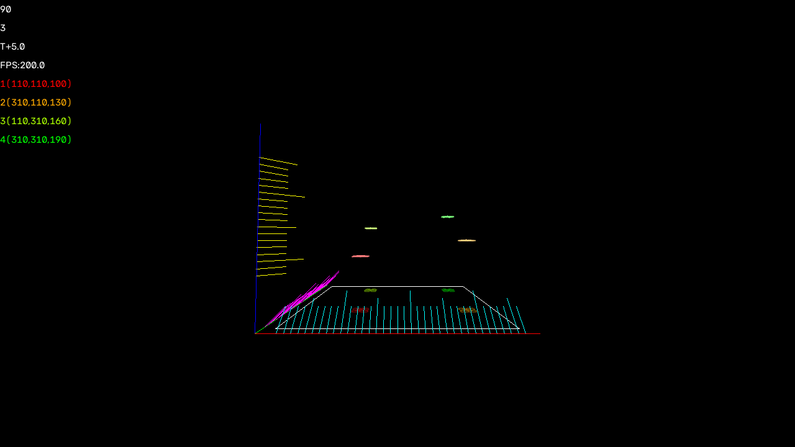
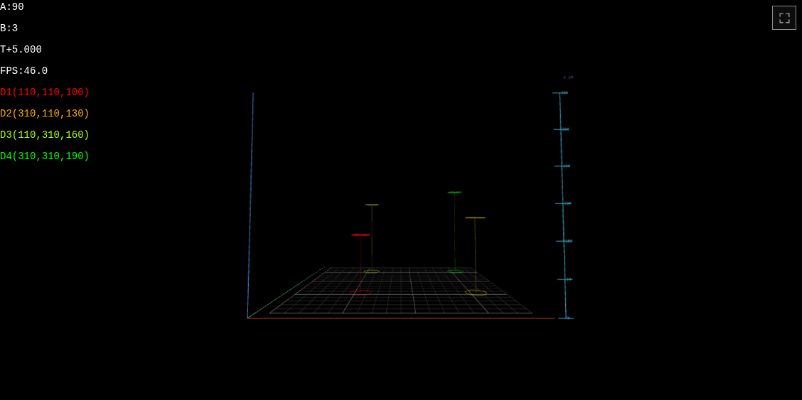
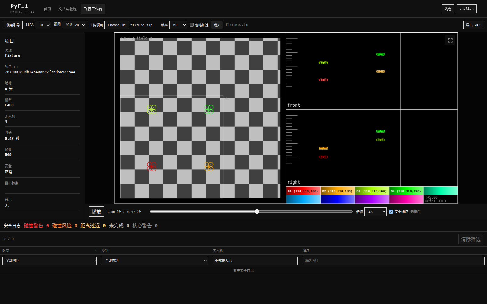
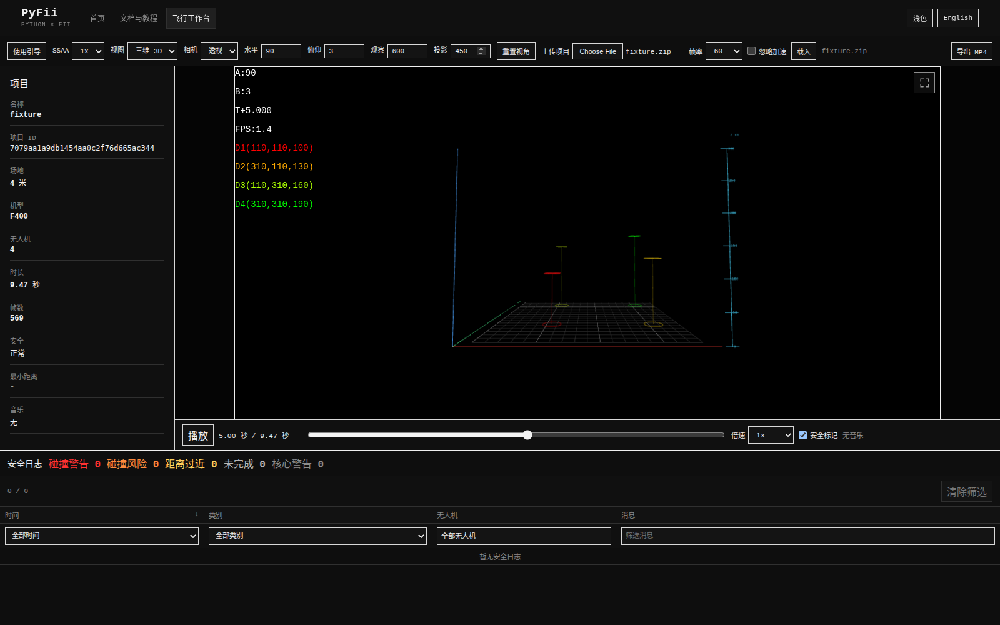

# 渲染回归与截图 CI

[Render screenshots](https://github.com/Kevin0412/pyfii/actions/workflows/render-screenshots.yml) 使用 Ubuntu、OpenCV 和 Playwright Chromium 执行两个独立的截图任务：

| 样例 | 采样时刻 | 目的 |
| --- | --- | --- |
| smoke：四机基础测试 | 5s | 验证基础渲染及 GUI 上传流程 |
| dntg：[大闹天宫](pyfii_script_patterns_human.md) | 6、13、25、33、49、56、61s | 展示真实七机编舞与渲染器差异 |

DNTG 复用原始编舞脚本，跳过交互播放入口和音乐。两套渲染器使用同一 Fii 工程、60 FPS 采样和默认评委视角；浏览器使用固定桌面视口及软件 WebGL。

## 产物与发布

每个时刻生成 OpenCV 2D/3D、浏览器 Canvas 2D/Three.js 3D、完整 2D/3D 工作台共六张 PNG。文件名以毫秒时间戳为前缀。Actions 的 `render-screenshots-smoke` 和 `render-screenshots-dntg` Artifact 另含工程 ZIP、采样元数据与服务日志，保留 14 天。

缺失或空白截图会导致任务失败；不同绘制后端不要求逐像素一致。仅默认分支的两个任务全部通过时，发布任务才更新 [render-gallery 分支](https://github.com/Kevin0412/pyfii/tree/render-gallery) 中的 PNG 与元数据；PR 与其他分支不发布。源码分支不积累生成图，生成分支保留正常 Git 历史。

## 本地复现

安装 core、GUI backend、前端依赖和 Playwright Chromium，并启动 GUI（默认 5173 端口），在仓库根目录运行：

```bash
python .github/scripts/render-screenshots.py core --sample dntg --output render-artifacts/dntg
python .github/scripts/render-screenshots.py browser --output render-artifacts/dntg
```

使用 `--sample smoke` 可切换到四机基础样例。

## 四机基础测试

### 5s

| OpenCV 2D | 浏览器 Canvas 2D |
| --- | --- |
|  |  |

| OpenCV 3D | 浏览器 Three.js 3D |
| --- | --- |
|  |  |

| 2D 完整工作台 | 3D 完整工作台 |
| --- | --- |
|  |  |


所有完整截图、工程 ZIP 和日志也可从 [Actions](https://github.com/Kevin0412/pyfii/actions/workflows/render-screenshots.yml) 下载。
